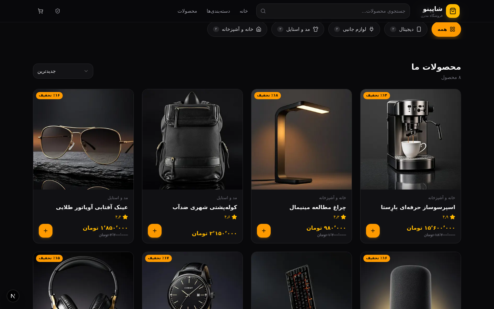
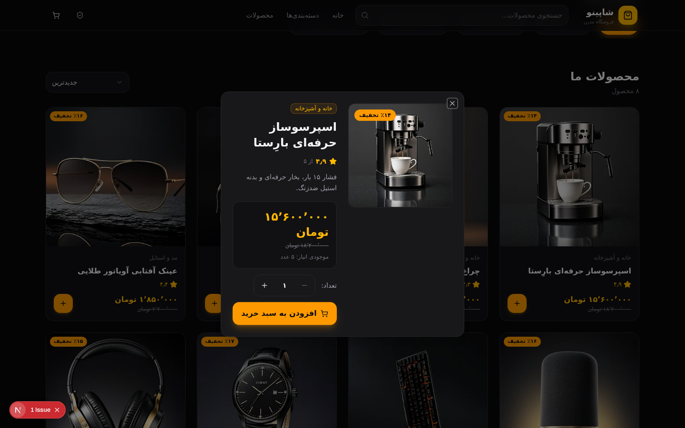
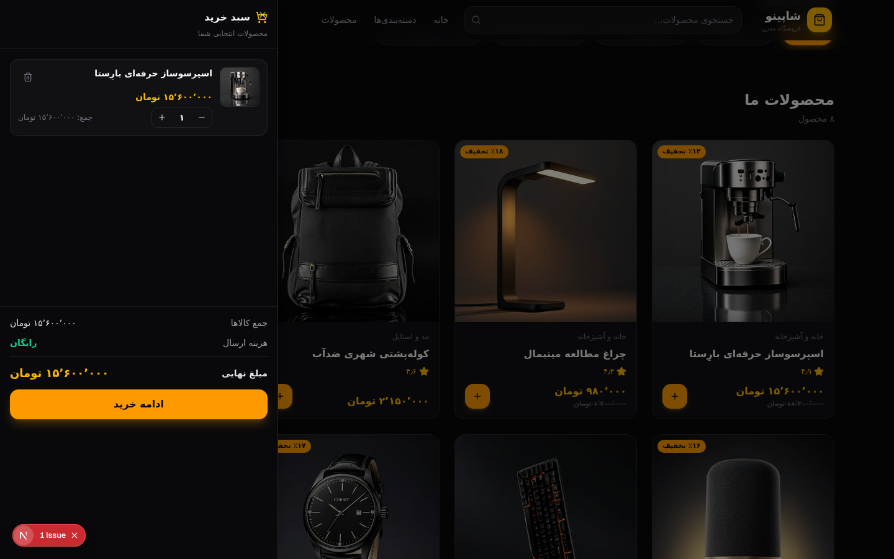
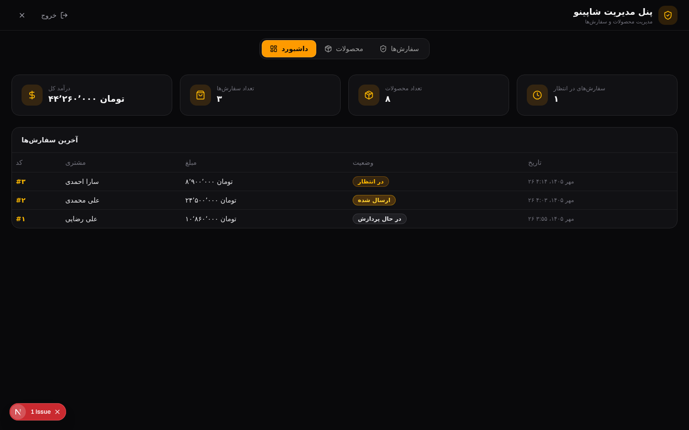
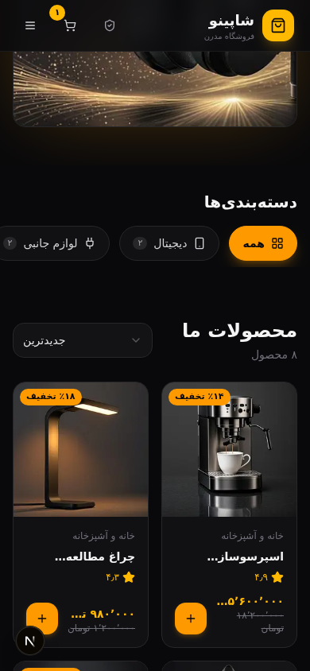

# 🛍️ شاپینو — فروشگاه آنلاین مدرن با تم دارک

<div dir="rtl">

فروشگاه اینترنتی فول‌استک و فارسی (RTL) با طراحی دارک لوکس، پنل مدیریت کامل، سبد خرید و ثبت سفارش — ساخته‌شده با **Next.js 16**، **TypeScript**، **Tailwind CSS 4** و **shadcn/ui**.

> 🔑 رمز ورود به پنل مدیریت: `admin123`

</div>

<div align="center">


</div>

## ✨ امکانات

<div dir="rtl">

- 🌙 **تم دارک لوکس** — پالت زینک + طلایی (amber) با فونت فارسی «وزیرمتن» و چیدمان کاملاً RTL
- 🏬 **فروشگاه کامل** — گرید محصولات، جستجوی زنده، فیلتر دسته‌بندی، مرتب‌سازی (جدیدترین/ارزان‌ترین/گران‌ترین/محبوب‌ترین)
- 🔍 **جزئیات محصول** — دیالوگ اختصاصی با گالری، تخفیف، امتیاز، انتخاب تعداد و وضعیت موجودی
- 🛒 **سبد خرید** — ذخیره‌سازی در localStorage (با Zustand persist)، افزایش/کاهش تعداد، حذف آیتم
- 💳 **ثبت سفارش** — فرم اعتبارسنجی‌شده (react-hook-form + zod)، محاسبه‌ی قیمت در سرور، کاهش خودکار موجودی
- 🛡️ **پنل مدیریت** — ورود با رمز، داشبورد آماری (درآمد، سفارش‌ها، محصولات)، CRUD کامل محصولات، مدیریت وضعیت سفارش‌ها
- 🔔 **نوتیفیکیشن** — توست‌های sonner برای همه‌ی اکشن‌ها
- 📱 **ریسپانسیو** — طراحی موبایل‌محور با تاچ‌تارگت استاندارد (۴۴px+)
- 🔢 **اعداد فارسی** — همه‌ی قیمت‌ها و تاریخ‌ها با فرمت `fa-IR` (تومان و تاریخ شمسی)

</div>

## 📸 اسکرین‌شات‌ها

<div align="center">

| محصولات | جزئیات محصول |
| :---: | :---: |
|  |  |
| **سبد خرید** | **پنل مدیریت** |
|  |  |
| **نسخه موبایل** | |
|  | |

</div>

## 🧰 تکنولوژی‌ها

| لایه | تکنولوژی |
| :--- | :--- |
| فریم‌ورک | Next.js 16 (App Router) · React 19 · TypeScript 5 |
| استایل | Tailwind CSS 4 · shadcn/ui (New York) · Lucide Icons |
| انیمیشن | Framer Motion |
| دیتابیس | Prisma ORM + SQLite |
| مدیریت state | Zustand (+ persist) · react-hook-form + zod |
| نوتیفیکیشن | Sonner |

## 🚀 راه‌اندازی

<div dir="rtl">

پیش‌نیاز: [Node.js 20+](https://nodejs.org) و [Bun](https://bun.sh) (یا npm/pnpm)

```bash
# ۱) نصب وابستگی‌ها
bun install

# ۲) ساخت فایل .env
echo 'DATABASE_URL="file:./db/custom.db"' > .env
# ⚠️ اگر از npm استفاده می‌کنید مسیر را مطلق کنید:
# DATABASE_URL="file:/full/path/to/project/db/custom.db"

# ۳) ایجاد دیتابیس
bun run db:push

# ۴) داده‌ی نمونه (۸ محصول + ۴ دسته‌بندی)
bun prisma/seed.ts

# ۵) اجرا
bun run dev
```

سپس `http://localhost:3000` را باز کنید.

**پنل مدیریت:** روی دکمه‌ی «پنل مدیریت» کلیک کنید و رمز `admin123` را وارد کنید.

</div>

## 🔌 API Endpoints

| متد | مسیر | توضیح |
| :--- | :--- | :--- |
| `GET` | `/api/products` | لیست محصولات (فیلتر: `q`, `category`, `featured`, `sort`) |
| `GET` | `/api/products/:id` | جزئیات محصول |
| `POST` `PUT` `DELETE` | `/api/products` | مدیریت محصولات 🔒 |
| `GET` `POST` | `/api/categories` | دسته‌بندی‌ها |
| `POST` | `/api/orders` | ثبت سفارش (عمومی — قیمت در سرور محاسبه می‌شود) |
| `GET` | `/api/orders` | لیست سفارش‌ها 🔒 |
| `PATCH` | `/api/orders/:id` | تغییر وضعیت سفارش 🔒 |
| `GET` | `/api/admin/stats` | آمار داشبورد 🔒 |
| `POST` | `/api/admin/login` | ورود مدیر |

> 🔒 = نیازمند هدر `x-admin-token` (پس از لاگین دریافت می‌شود)

## 🗂️ ساختار پروژه

```
├── prisma/
│   ├── schema.prisma        # مدل‌های Category, Product, Order, OrderItem
│   └── seed.ts              # داده‌ی نمونه (idempotent)
├── src/
│   ├── app/
│   │   ├── api/             # REST API routes
│   │   ├── layout.tsx       # فونت وزیرمتن + RTL + تم دارک
│   │   └── page.tsx
│   ├── components/
│   │   ├── store/           # Header, Hero, ProductGrid, Cart, Checkout, ...
│   │   └── store/admin/     # پنل مدیریت (داشبورد، محصولات، سفارش‌ها)
│   ├── lib/                 # db, types, format (اعداد فارسی), admin
│   └── store/               # Zustand (سبد خرید + state)
└── public/images/           # تصاویر محصولات (تولیدشده با AI)
```

## 📄 لایسنس

MIT

</div>
