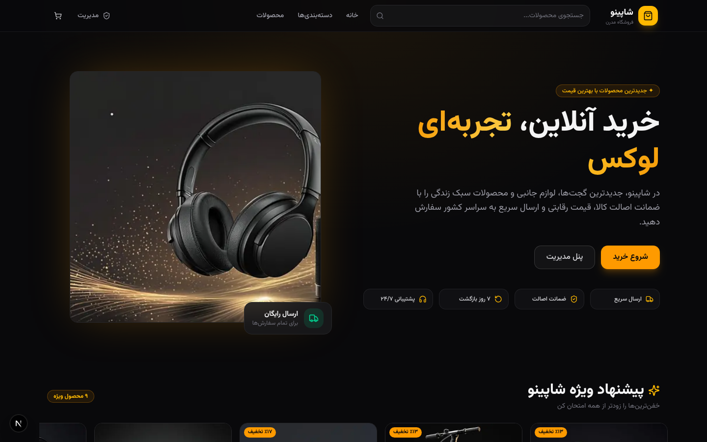
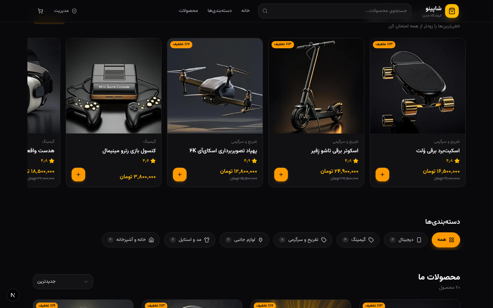
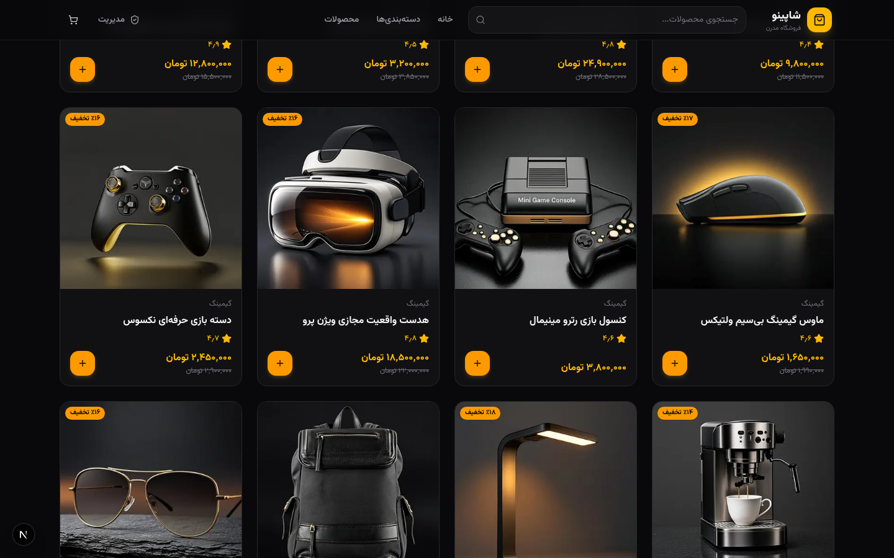
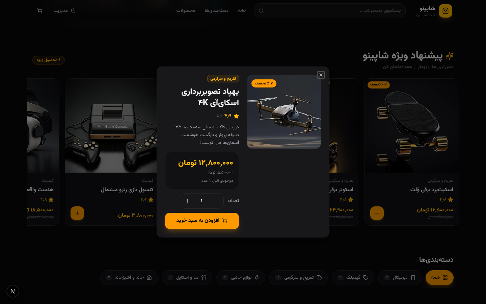
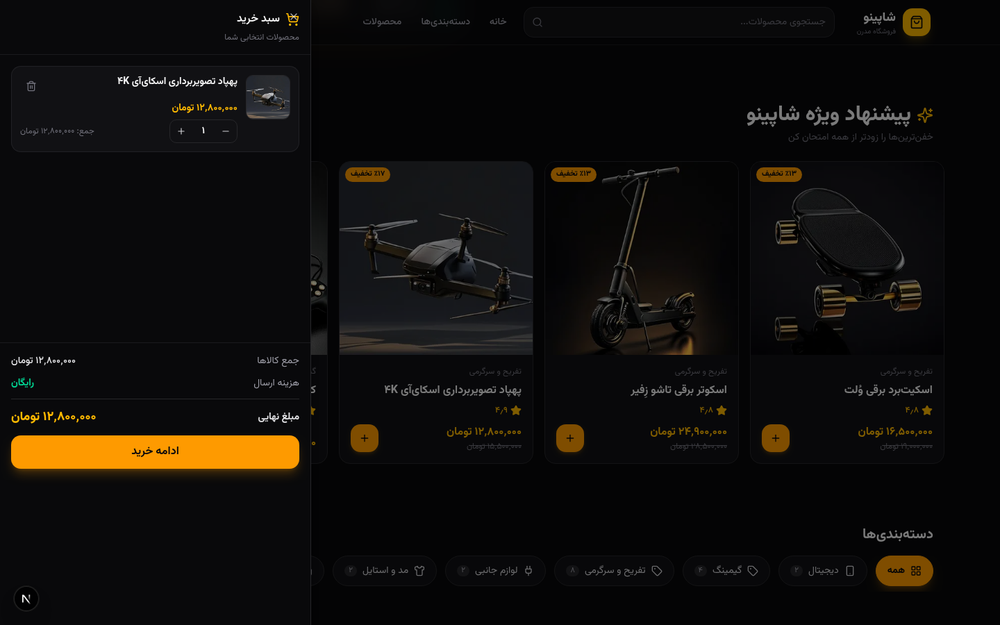
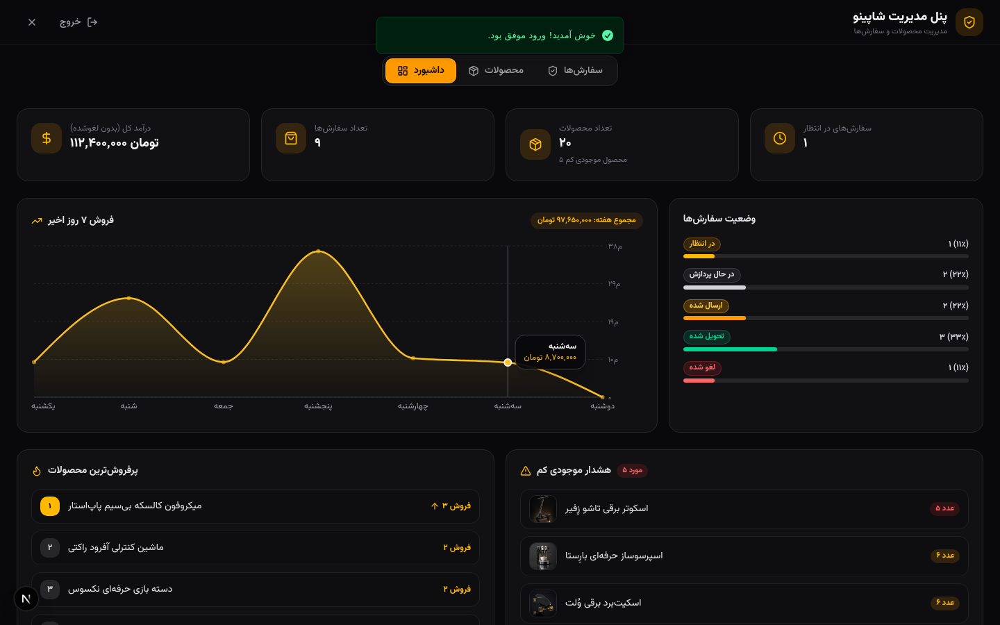
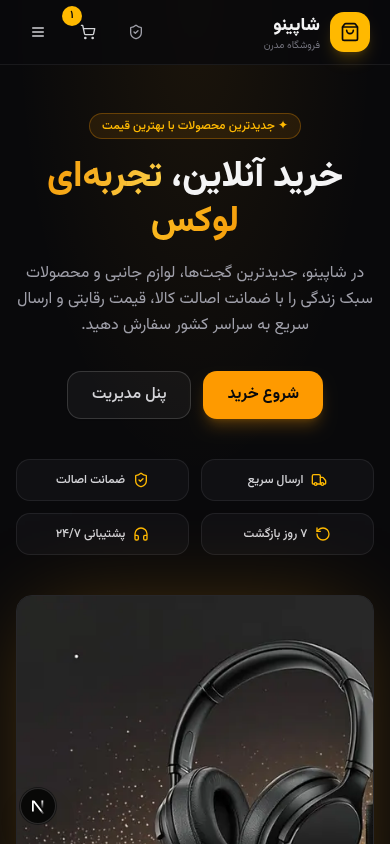

# 🛍️ شاپینو — فروشگاه آنلاین مدرن با تم دارک

<div dir="rtl">

فروشگاه اینترنتی فول‌استک و فارسی (RTL) با طراحی دارک لوکس، **۲۰ محصول تفریحی و گیمینگ**، پنل مدیریت حرفه‌ای با نمودار فروش، سبد خرید و ثبت سفارش — ساخته‌شده با **Next.js 16**، **TypeScript**، **Tailwind CSS 4** و **shadcn/ui**.

> 🔑 رمز ورود به پنل مدیریت: `admin123` — از دکمه «مدیریت» در هدر، لینک «ورود مدیران» در فوتر یا دکمه پنل مدیریت در صفحه اصلی

</div>

<div align="center">



</div>

## ✨ امکانات

<div dir="rtl">

### فروشگاه
- 🌙 **تم دارک لوکس** — پالت زینک + طلایی (amber) با فونت فارسی «وزیرمتن» و چیدمان کاملاً RTL
- ✨ **پیشنهاد ویژه** — ردیف افقی محصولات منتخب با اسکرول snap
- 🏬 **گرید محصولات** — ۲۰ محصول در ۶ دسته‌بندی (دیجیتال، گیمینگ، تفریح و سرگرمی، لوازم جانبی، مد، خانه)
- 🔍 **جستجوی زنده** + مرتب‌سازی (جدیدترین/ارزان‌ترین/گران‌ترین/محبوب‌ترین)
- 🔮 **محصولات خفن** — هدست VR، پهپاد ۴K، اسکوتر برقی، اسکیت‌برد برقی، هاوربورد، کنسول رترو و...
- 🛒 **سبد خرید** — ذخیره در localStorage (Zustand persist)، افزایش/کاهش تعداد، حذف آیتم
- 💳 **ثبت سفارش** — اعتبارسنجی (react-hook-form + zod)، محاسبه قیمت در سرور، کاهش خودکار موجودی
- 🔢 **اعداد و تاریخ فارسی** — قیمت تومانی، تاریخ شمسی و اعداد فارسی در کل سایت

### پنل مدیریت 🛡️
- 📊 **داشبورد حرفه‌ای** — نمودار فروش ۷ روز اخیر (recharts)، درآمد کل، تعداد سفارش‌ها
- 🔥 **پرفروش‌ترین محصولات** — رتبه‌بندی بر اساس تعداد فروش واقعی
- ⚠️ **هشدار موجودی کم** — لیست محصولات رو به اتمام با تصویر
- 📈 **وضعیت سفارش‌ها** — نمودار درصدی هر وضعیت (در انتظار تا تحویل شده)
- 📦 **مدیریت محصولات** — افزودن/ویرایش/حذف کامل با فرم اعتبارسنجی‌شده
- 🚚 **مدیریت سفارش‌ها** — تغییر وضعیت سفارش‌ها با یک کلیک
- 🔔 **نوتیفیکیشن** — توست‌های sonner برای همه اکشن‌ها

</div>

## 📸 اسکرین‌شات‌ها

<div align="center">

| پیشنهاد ویژه | محصولات |
| :---: | :---: |
|  |  |
| **جزئیات محصول** | **سبد خرید** |
|  |  |
| **پنل مدیریت — داشبورد** | **نسخه موبایل** |
|  |  |

</div>

## 🧰 تکنولوژی‌ها

| لایه | تکنولوژی |
| :--- | :--- |
| فریم‌ورک | Next.js 16 (App Router) · React 19 · TypeScript 5 |
| استایل | Tailwind CSS 4 · shadcn/ui (New York) · Lucide Icons |
| انیمیشن | Framer Motion |
| نمودار | Recharts |
| دیتابیس | Prisma ORM + SQLite |
| مدیریت state | Zustand (+ persist) · react-hook-form + zod |
| نوتیفیکیشن | Sonner |

## 🚀 راه‌اندازی

<div dir="rtl">

پیش‌نیاز: [Node.js 20+](https://nodejs.org) و [Bun](https://bun.sh) (یا npm/pnpm)

```bash
# ۱) نصب وابستگی‌ها
bun install

# ۲) ساخت فایل .env
echo 'DATABASE_URL="file:./db/custom.db"' > .env
# ⚠️ اگر از npm استفاده می‌کنید مسیر را مطلق کنید:
# DATABASE_URL="file:/full/path/to/project/db/custom.db"

# ۳) ایجاد دیتابیس
bun run db:push

# ۴) داده‌ی نمونه (۲۰ محصول، ۶ دسته‌بندی و ۹ سفارش نمونه)
bun prisma/seed.ts

# ۵) اجرا
bun run dev
```

سپس `http://localhost:3000` را باز کنید.

**پنل مدیریت:** دکمه «مدیریت» در هدر (یا «ورود مدیران» در فوتر) → رمز `admin123`

</div>

## 🔌 API Endpoints

| متد | مسیر | توضیح |
| :--- | :--- | :--- |
| `GET` | `/api/products` | لیست محصولات (فیلتر: `q`, `category`, `featured`, `sort`) |
| `GET` | `/api/products/:id` | جزئیات محصول |
| `POST` `PUT` `DELETE` | `/api/products` | مدیریت محصولات 🔒 |
| `GET` `POST` | `/api/categories` | دسته‌بندی‌ها |
| `POST` | `/api/orders` | ثبت سفارش (عمومی — قیمت در سرور محاسبه می‌شود) |
| `GET` | `/api/orders` | لیست سفارش‌ها 🔒 |
| `PATCH` | `/api/orders/:id` | تغییر وضعیت سفارش 🔒 |
| `GET` | `/api/admin/stats` | آمار داشبورد (درآمد، نمودار، پرفروش‌ها، موجودی کم) 🔒 |
| `POST` | `/api/admin/login` | ورود مدیر |

> 🔒 = نیازمند هدر `x-admin-token` (پس از لاگین دریافت می‌شود)

## 🗂️ ساختار پروژه

```
├── prisma/
│   ├── schema.prisma        # مدل‌های Category, Product, Order, OrderItem
│   └── seed.ts              # داده نمونه: ۲۰ محصول، ۶ دسته، ۹ سفارش (idempotent)
├── src/
│   ├── app/
│   │   ├── api/             # REST API routes
│   │   ├── layout.tsx       # فونت وزیرمتن + RTL + تم دارک
│   │   └── page.tsx
│   ├── components/
│   │   ├── store/           # Header, Hero, FeaturedRow, ProductGrid, Cart, Checkout, ...
│   │   └── store/admin/     # پنل مدیریت (داشبورد با نمودار، محصولات، سفارش‌ها)
│   ├── lib/                 # db, types, format (اعداد فارسی), admin
│   └── store/               # Zustand (سبد خرید + state)
└── public/images/           # ۲۰ تصویر محصولات + هیرو (تولیدشده با AI)
```

## 📄 لایسنس

MIT
